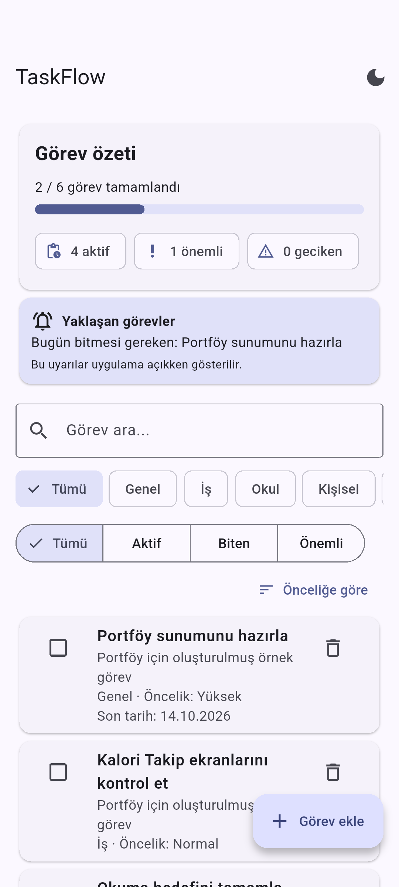
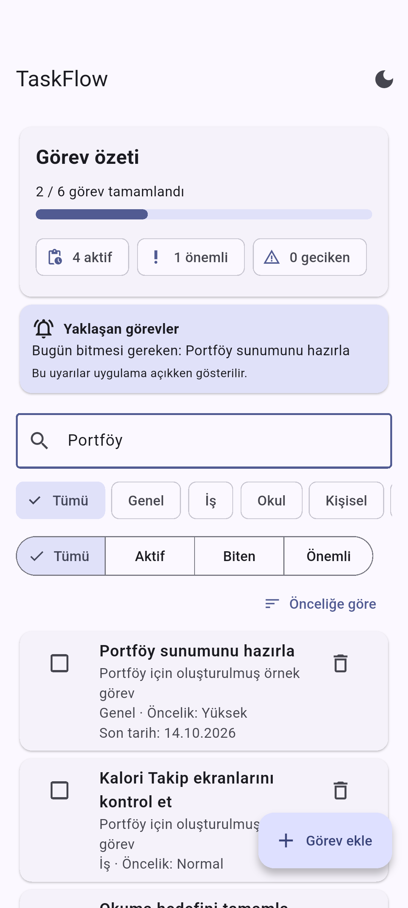
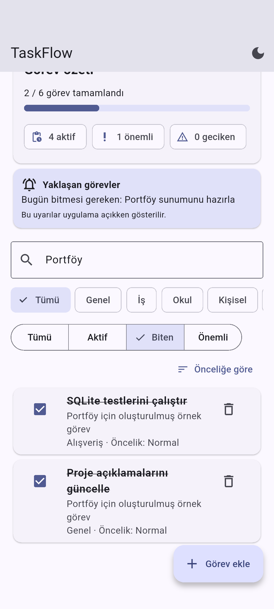
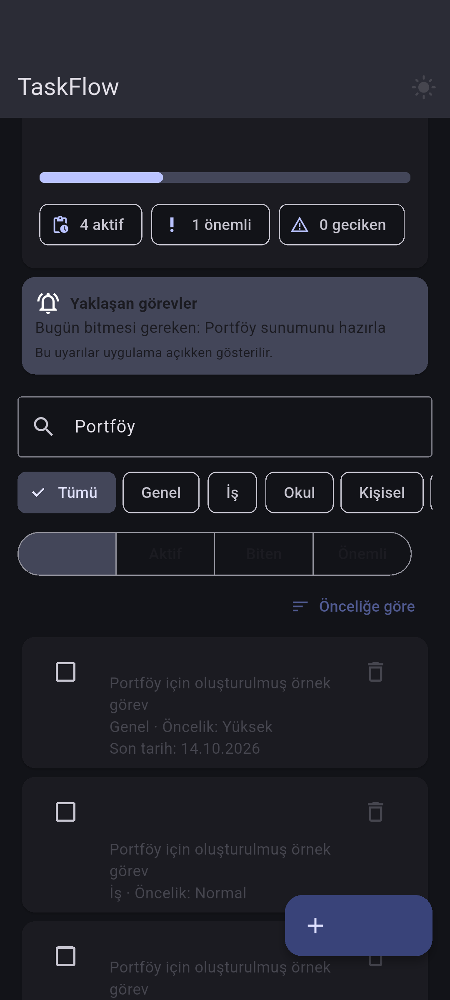

# TaskFlow — Görev Yönetimi

Flutter ve Dart ile geliştirilen Android uygulaması; görevleri öncelik, kategori ve son tarihe göre düzenlemeyi sağlar. Görevler SQLite ile cihazda, tema tercihi SharedPreferences ile saklanır.

[](https://github.com/alidanis61615/TaskFlow/actions/workflows/flutter-checks.yml)
[](https://github.com/alidanis61615/TaskFlow/actions/workflows/build-apk.yml)

**[Ekranlar](#ekran-görüntüleri) · [Özellikler](#özellikler) · [Kurulum](#yerelde-çalıştırma) · [Android APK indir](https://github.com/alidanis61615/TaskFlow/releases/latest)**

## Bu portföy sürümündeki katkım

Görev modeli, SQLite CRUD, kategori/öncelik/son tarih akışları ve arama/filtreleme üzerinde çalıştım. Model, veri erişimi, sorgu mantığı, ekran ve düzenleme formunu ayrı dosyalara ayırdım.

**Teknik kararım:** Veritabanı sürüm geçişleriyle mevcut görevleri korumak ve ekranın veri kaynağını bir repository arayüzü üzerinden kullanmak. Böylece veri işlemleri ile arayüz ayrı test edilebilir.

**Çözdüğüm hata:** Boş görev başlığının kaydedilmesini engelledim ve veri yükleme/kaydetme hatalarını kullanıcıya gösterdim. SQLite sürüm 1 → 3 geçişinde eski görevlerin korunmasını otomatik testle doğruladım. Android testinin yakaladığı, klavye açıkken küçük ekran taşmasını kaydırılabilir görünümle düzelttim ve bir regresyon testi ekledim.


## Teknik incelemeye hızlı başlangıç

| İnceleme | Kaynak |
| --- | --- |
| Görev modeli, SQLite CRUD ve veritabanı sürüm geçişleri | [Model](lib/models/task.dart) · [SQLite servisi](lib/services/task_database.dart) |
| Arama, filtreler, tema ve görev ekranları | [Ekran](lib/screens/task_home.dart) · [Görev formu](lib/widgets/task_editor.dart) · [Sorgular](lib/services/task_query.dart) |
| Görev, SQLite sürüm geçişi ve ekran davranışları | [Otomatik testler](test/) |
| Analiz ve test süreci | [GitHub Actions](.github/workflows/flutter-checks.yml) |

## Ekran görüntüleri

Android emülatöründe çalışan uygulamadan alınan gerçek arayüz görüntüleri. Görevler **kurgusal portföy kayıtlarıdır**. Ekranlar [Android test akışı](.github/workflows/android-demo.yml) ile yeniden oluşturulabilir.

| Görev listesi | Arama | Tamamlanan görevler | Koyu tema |
| --- | --- | --- | --- |
|  |  |  |  |

## Özellikler

- Başlık, açıklama ve düşük/normal/yüksek öncelik ile görev ekleme ve düzenleme.
- Genel, iş, okul, kişisel ve alışveriş kategorileri; kategoriye göre filtreleme.
- Son tarih seçme/kaldırma ve geciken görevleri vurgulama.
- Görev tamamlama, tamamlanma oranı ve silmeden önce onay.
- Başlık/açıklama içinde arama; tümü, aktif, biten ve önemli görev filtreleri.
- Varsayılan, en yeni ve son tarih sıralamaları.
- Açık/koyu tema; yeniden açılışta tema ve görev kayıtlarının korunması.

## Bir dakikalık demo

1. Bir görev ekleyin; öncelik, kategori ve son tarih belirleyin.
2. Arama ve kategori/durum filtreleriyle görevi bulun.
3. Görevi tamamlayın; istatistik ve ilerleme çubuğunu inceleyin.
4. Temayı değiştirin ve uygulamayı yeniden açarak kayıtları kontrol edin.

## Teknik yapı

| Katman | Uygulama |
| --- | --- |
| Arayüz | Flutter Material 3; `TaskFlowApp`, `TaskHome` |
| Durum yönetimi | `setState()` ve veri değişikliklerinden sonra `refresh()` |
| Model | `Task`; `toMap()`, `fromMap()`, `copyWith()` |
| Veritabanı | `TaskDatabase` singleton; `sqflite`, parametreli güncelleme/silme |
| Tercihler | SharedPreferences ile açık/koyu tema |
| Kontroller | Model, sorgu, gerçek SQLite ve widget testleri; GitHub Actions ile analiz, test ve APK derlemesi |

### SQLite şeması

`taskflow.db` dosyasındaki `tasks` tablosu, veritabanı sürümü **3**:

| Alan | Tür | Kullanım |
| --- | --- | --- |
| `id` | INTEGER PRIMARY KEY AUTOINCREMENT | Görev kimliği |
| `title` | TEXT NOT NULL | Başlık |
| `description` | TEXT NOT NULL | Açıklama |
| `priority` | INTEGER NOT NULL | 0 düşük, 1 normal, 2 yüksek |
| `completed` | INTEGER NOT NULL | 0 aktif, 1 tamamlandı |
| `created_at` | TEXT NOT NULL | Oluşturulma zamanı |
| `due_date` | TEXT | İsteğe bağlı son tarih |
| `category` | TEXT NOT NULL | Varsayılan: Genel |

Sürüm geçişleri eski kayıtlara `due_date` ve `category` alanlarını ekler. Varsayılan sorgu sırası `completed ASC, priority DESC, created_at DESC` biçimindedir. Arama, filtreler ve alternatif sıralamalar arayüzde uygulanır.

## Yerelde çalıştırma

Flutter stable (Dart 3.12 veya üstü), Android araçları ve bir cihaz/emülatör gerekir. Android proje dosyaları ilk kurulumda üretilir.

```bash
git clone https://github.com/alidanis61615/TaskFlow.git
cd TaskFlow
flutter create --platforms=android --project-name taskflow .
rm -f test/widget_test.dart
flutter pub get
flutter run
```

Oluşturulan örnek `widget_test.dart`, uygulamanın `TaskFlowApp` sınıfını kullanmadığı için kaldırılır; `task_model_test.dart` korunur. Windows PowerShell'de `Remove-Item test/widget_test.dart -ErrorAction SilentlyContinue` kullanılabilir.

## Analiz ve test

```bash
flutter analyze
flutter test
```

Testler; görev ekleme/düzenleme/tamamlama/silme, sürüm 1 → 3 veritabanı geçişi, arama, kategori/durum filtreleri ve tarih sıralamasını kapsar. Widget testleri ekrandan görev oluşturma, arama, tamamlama, onayla silme ve boş başlığı reddetme akışını çalıştırır. SQLite testleri gerçek bir geçici/in-memory veritabanı kullanır.

## APK indirme

**[GitHub Releases → Android APK indir](https://github.com/alidanis61615/TaskFlow/releases/latest)**. Sürüm sayfasının **Assets** bölümündeki `TaskFlow-Android.apk` dosyasını indirin. Kalıcı sürüm dosyası, geçici Actions artefaktının saklama süresine bağlı değildir.

APK, analiz ve testlerden sonra derlenir. Portföy demosu için üretilen APK'dır; mağaza dağıtımı için ayrı üretim imzası gerekir. Yeni sürüm yayınlama, `Build Android APK` iş akışının `main` üzerinden **publish** seçeneğiyle elle çalıştırılır.

## Proje hakkında

Portföy için yeniden oluşturulmuş bir görev yönetimi projesidir. Bu depo güncel bağımsız sürümü içerir; `index/projects/taskflow` klasöründeki öğrenme sürümü ayrı bir çalışmadır.

**Geliştirici:** [Ali Danış](https://github.com/alidanis61615) · Mobil Teknolojileri mezunu, Yazılım Geliştirici
